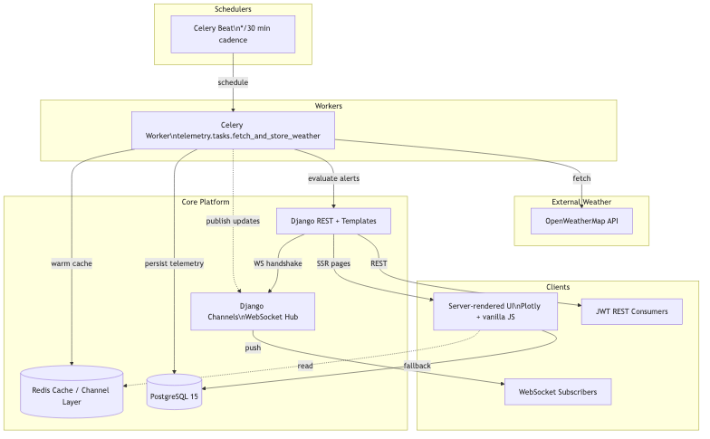

# Space Weather Monitoring Platform

Mission-ready weather intelligence for satellite ground stations with automated alerting, real-time dashboards, and resilient background ingestion.

---

## Project Overview

Multi-tenant Django platform that captures weather telemetry, evaluates alert thresholds, and notifies operators guarding space infrastructure. Scope follows the take-home brief: functional SSR dashboard, authenticated REST API, Celery-based ingestion, deployable in Docker, and documented design rationale under 500 words.

---

## Architecture

- Django REST + templates serve both API and SSR pages.
- Celery beat/worker pipeline pulls OpenWeatherMap every 30 minutes and evaluates alerts.
- Redis provides cache, channel layer, and Celery broker; PostgreSQL persists telemetry.
- WebSocket updates keep dashboard status cards and Plotly chart current.



> Need a visual? The original Mermaid source lives at `docs/architecture.mmd`; render or screenshot it as needed without affecting the 500-word limit.

---

## Getting Started

### Local (Python 3.11)

```bash
cp env.example .env
python -m venv .venv && source .venv/bin/activate
pip install -r requirements.txt
python manage.py migrate
python manage.py createsuperuser
python manage.py runserver 0.0.0.0:8000
celery -A core worker -l info
celery -A core beat -l info
```

### Docker Compose

```bash
cp env.example .env
docker compose up --build
```

Key endpoints:

- `http://localhost:8000` dashboard + REST
- `http://localhost:8000/api/docs/` Swagger UI
- `ws://localhost:8000/ws/updates/` WebSocket feed

Sample data: add locations via Django admin, create alert configs, run Celery beat or trigger `fetch_and_store_weather` manually.

---

## API Surface

Base URL: `https://<host>/api/`

| Method | Endpoint                           | Purpose                        |
| ------ | ---------------------------------- | ------------------------------ |
| `GET`  | `/locations/`                      | List user's locations          |
| `POST` | `/locations/`                      | Add location (name + coords)   |
| `GET`  | `/weather/{location_id}/?hours=24` | Latest + time series telemetry |
| `POST` | `/alerts/config/`                  | Configure alert threshold      |
| `GET`  | `/alerts/history/`                 | Recent alert events            |

JWT auth secures the API; session auth powers SSR pages. Swagger UI contains schema examples for all endpoints.

---

## Background Jobs & Alerts

- `django-celery-beat` schedules `telemetry.tasks.fetch_and_store_weather` every 30 minutes.
- Ingestion enforces a 1.1s delay between API calls to stay within OpenWeatherMap free tier.
- `(location, timestamp)` uniqueness guards against duplicate telemetry.
- Alerts persist to `AlertHistory`, attempt email via `ALERT_NOTIFICATION_EMAIL`, and broadcast WebSocket updates.

---

## Configuration

Copy `.env.example` and set at minimum:

```
SECRET_KEY=change-me
DEBUG=False
ALLOWED_HOSTS=localhost,weather.example.com
POSTGRES_DB=space_weather
POSTGRES_USER=space_admin
POSTGRES_PASSWORD=supersecret
POSTGRES_HOST=postgres
OWM_API_KEY=<openweathermap-key>
CELERY_BROKER_URL=redis://redis:6379/0
CELERY_RESULT_BACKEND=redis://redis:6379/1
CACHE_URL=redis://redis:6379/2

# Optional email alerts
EMAIL_BACKEND=django.core.mail.backends.smtp.EmailBackend
ALERT_NOTIFICATION_EMAIL=alerts@example.com
```

Gmail users should enable 2FA and create an App Password before populating `EMAIL_HOST_PASSWORD`.

---

## Design Decisions (≤500 words)

- **Data model**: `Location`, `Telemetry`, `AlertConfig`, `AlertHistory`, and `GeocodeCache` remain lean. `Telemetry` enforces `(location, timestamp)` uniqueness for idempotent writes; alerts only record triggered events.
- **Caching**: Redis keys `weather:<user>:<location>:<hours>` separate tenant data. TTL keeps dashboards near real time while respecting API quotas; `GeocodeCache` accelerates repeated lookups.
- **Background jobs**: Single beat schedule keeps orchestration simple. Tasks catch typed exceptions, apply retry/backoff for email, and inline alert evaluation to avoid extra queues while workloads stay modest.
- **Scale path**: For 1000+ locations, shard Celery workers by queue, move Redis to managed hosting, front API with PgBouncer, pre-compute hourly aggregates for dashboards, and run multiple ASGI instances behind Nginx or ALB.

Word count ≈ 160.

---

## Submission & Ops Notes

- Docker image builds via `docker build -t space-weather-web .`.
- Managed Postgres + Redis plus `python manage.py migrate` prepares staging/production.
- `.env.example` and Swagger docs summarize setup in the handoff email.
- Private GitHub repo shared with `perceptivespace`; deployment credentials in the delivery email.

---

## AI Assistance Disclosure

Tools: Cursor (lint suggestions), GitHub Copilot CLI (test command stubs). Usage limited to verifying `ruff`/`pytest` commands and wording edits; architecture, data modeling, and documentation remain authored manually.

---

Space Weather Monitoring Platform — built for resilient satellite operations with pragmatic, production-grade engineering.
