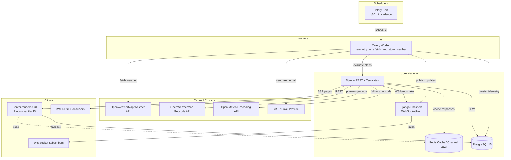

# Space Weather Monitoring Platform

Production-ready weather monitoring for satellite ground stations. Fetches OpenWeatherMap data, stores telemetry, evaluates thresholds, and surfaces results via SSR dashboard, JWT API, WebSockets, and email alerts.

- Repo: https://github.com/dgsglryz/space-weather-monitoring-platform
- Diagram: view the Mermaid source directly at `docs/architecture.mmd`
- Local demo: username `demo`, password `1234`



## Features

- Django 4.2 + DRF backend (SSR + JWT; OpenAPI at `/api/docs/`)
- PostgreSQL models for locations, telemetry, alert configs, alert history
- Celery beat/worker ingest every 30 minutes with email retry/backoff
- Channels WebSocket pushes live readings to dashboards
- Plotly renders 24-hour charts and history metrics; historical drill-down adds min/max/avg summaries per location
- Docker Compose stack: Daphne web, worker, beat, PostgreSQL, Redis

## Setup

### Local Development

```bash
cp env.example .env
python -m venv .venv && source .venv/bin/activate
pip install -r requirements.txt
python manage.py migrate

# (optional) load sample data – expects a user named 'demo'
python manage.py createsuperuser --username demo --email demo@example.com
python manage.py loaddata fixtures/sample_data.json
python manage.py runserver

# in parallel terminals
celery -A core worker -l info
celery -A core beat -l info
```

- Vars: `.env.example` ships with working defaults (PostgreSQL db/user/password all `space`, Redis URLs, console email backend). Set `OWM_API_KEY` if you want live weather ingestion.
- Alert emails: switch `EMAIL_BACKEND` to the SMTP backend and fill `EMAIL_HOST` (e.g. `smtp.gmail.com`), `EMAIL_HOST_USER`, `EMAIL_HOST_PASSWORD` (plus TLS/SSL flags) if you want outbound alerts instead of console logs.
- Docker compose uses the same `.env`; update secrets there before deploying beyond local.
- Sample data lives in `fixtures/sample_data.json` (Toronto, Vancouver, Houston + alerts + 24h telemetry); load it after creating the `demo` user as above.

- Admin UI: `/admin/`
- WebSocket feed: `ws://localhost:8000/ws/updates/`

### Docker

```bash
cp env.example .env
docker compose up --build
```

## API Reference

- `POST /api/auth/token/`
  ```json
  { "username": "demo", "password": "1234" }
  ```
  Response →
  ```json
  { "access": "<jwt>", "refresh": "<jwt>" }
  ```
- `GET /api/locations/`
  ```json
  [
    {
      "id": 1,
      "name": "Cape Canaveral",
      "latitude": 28.396837,
      "longitude": -80.605659
    }
  ]
  ```
- `POST /api/locations/`
  ```json
  { "name": "Toronto", "latitude": 43.65, "longitude": -79.38 }
  ```
- `GET /api/weather/<id>/?hours=24`
  ```json
  {
    "location": 1,
    "latest": {
      "timestamp": "2025-11-07T17:30:00Z",
      "temperature_c": 22.1,
      "wind_speed_ms": 5.4,
      "humidity": 68
    },
    "series": [
      {
        "timestamp": "2025-11-07T16:30:00Z",
        "temperature_c": 21.4,
        "wind_speed_ms": 4.8,
        "humidity": 70
      }
    ]
  }
  ```
- `POST /api/alerts/config/`
  ```json
  {
    "location": 1,
    "threshold_type": "temp_gt",
    "threshold_value": 30,
    "is_active": true
  }
  ```
- `GET /api/alerts/history/`
  ```json
  [
    {
      "location": 1,
      "condition": "temp_gt",
      "value": 34.2,
      "triggered_at": "2025-11-07T16:30:00Z",
      "user_notified": true
    }
  ]
  ```

Full schema: `/api/docs/`.

## Environment Variables

All variables live in `.env.example`: Django runtime, PostgreSQL, Redis/Celery URLs, `OWM_API_KEY`, SMTP credentials, and cache tuning knobs.

## Testing

```bash
python manage.py test --settings=core.test_settings
```

Uses in-memory database/cache and Celery eager mode.

## Design Decisions

- **Database.** PostgreSQL keeps telemetry, locations, alerts, and histories consistent, with `(location, timestamp)` uniqueness and targeted indexes. Scaling to 1,000+ locations would lean on partitioning plus read replicas.
- **Caching & rate limits.** Fetch cadence matches OpenWeatherMap’s free tier. Redis caches per-user/location windows and also backs Celery broker/result plus the WebSocket layer, so dashboards refresh without extra API calls.
- **Background jobs.** Celery supplies scheduling and retries. Each ingest writes telemetry, evaluates thresholds, stores alert history, and sends email with configurable retry/backoff.
- **SSR & UX.** Django templates keep pages lightweight. Plotly renders interactive 24-hour charts, while WebSockets stream live deltas. The history page adds min/max/avg summaries and last-updated timestamps.
- **Scalability.** Additional Celery workers, Redis queues, and indexed tables handle growth; Docker Compose mirrors production deployment, easing moves to managed infrastructure.

## AI Disclosure

Received light support from Cursor (ChatGPT-based) for polishing documentation phrasing, brainstorming test scenarios, and tightening inline comments. Architecture, application code, Celery/Redis integration, and final verification were handled directly by me.
